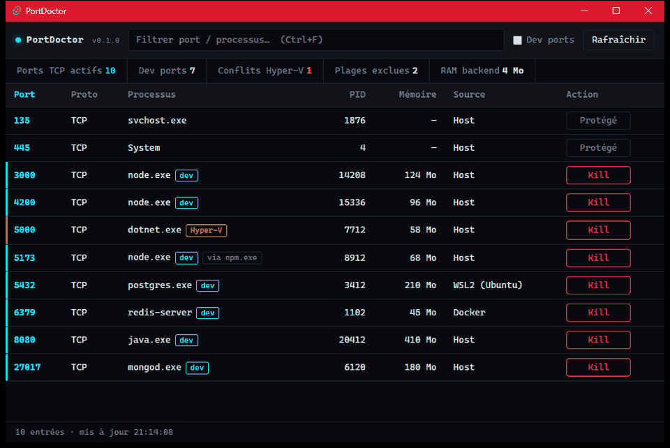
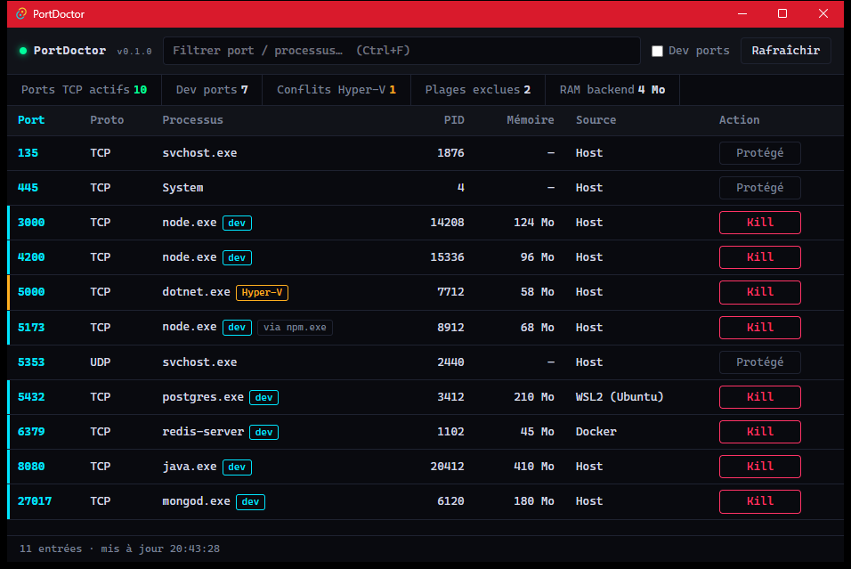
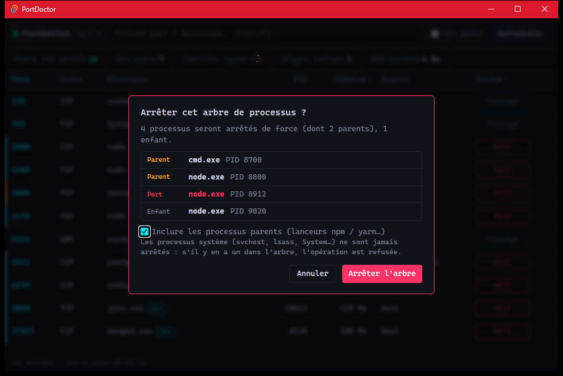

# PortDoctor (v0.2.0)

🇬🇧 [English version](README.md)

[](https://github.com/TxF-AI/port-doctor/releases/latest)


[](LICENSE)

**Libère en un clic les ports bloqués de ton PC Windows, directement depuis la zone de notification.**

## Le problème : `EADDRINUSE`

```
Error: listen EADDRINUSE: address already in use :::3000
```

Un `npm run dev` fermé à la va-vite, un `node.exe` zombie qui tient encore le port 3000, un `postgres` oublié dans WSL2, une plage de ports réservée par Hyper-V sans que tu le saches : tu perds dix minutes à chercher `netstat -ano | findstr :3000`, puis `taskkill`.

**PortDoctor** liste tous les ports en écoute, te dit qui les tient (processus, chemin, mémoire, provenance Host / WSL2 / Docker) et libère le port en un clic, avec des garde-fous pour ne jamais toucher à Windows. Application native (Rust + Tauri v2), un seul exécutable portable de 4,3 Mo, discrète dans le System Tray. Rien n'est envoyé sur Internet. Interface **bilingue FR / EN** (sélecteur en haut à droite ; langue du système par défaut).

## 🎨 Aperçu de l'Interface



*Démo animée (données fictives) : Kill du port 5173, modale Smart Kill (arbre `cmd` → `node` → `node` → enfant), confirmation et port libéré.*

<details>
<summary>Captures statiques</summary>



Interface **HUD cyberpunk compacte**, affichée depuis l'icône du **System Tray** (clic gauche). Le tableau dense liste les ports **TCP et UDP** avec PID, processus, mémoire et **source** : `Host`, `WSL2 (Ubuntu)` ou `Docker`. La barre de compteurs résume les ports actifs, les **Dev ports** (filtre et liseré bleu), les **conflits Hyper-V** (liseré et badge ambre, ici le port 5000 tombe dans une plage réservée) ; les processus système sont verrouillés (`Protégé`). Le champ de recherche (`Ctrl+F`) filtre par port, nom ou PID.



Quand un processus a des enfants ou un lanceur `npm` / `yarn` au-dessus, le bouton **Kill** ouvre la modale de **Smart Kill** : elle liste l'arbre exact (parents, processus du port, enfants) et permet d'exclure les parents avant d'arrêter.

> Les captures utilisent des **données de démonstration** (aucun nom d'utilisateur ni processus réel de la machine).

</details>

## Fonctionnalités

| Fonction | Détail |
|---|---|
| 🔌 **Inspection System Tray** | Ports TCP en écoute et sockets UDP liés, avec adresse (`0.0.0.0`, `127.0.0.1`, `::1`), PID, processus, chemin, mémoire. Tri, filtre instantané (`Ctrl+F`), vue « Dev ports » (3000, 3001, 4200, 5173, 8000, 8080, 3306, 5432, 6379, 27017). Fermer la fenêtre la réduit dans le tray. |
| 💥 **Kill 1-clic** | Arrêt forcé du processus qui tient le port, après une confirmation visuelle (« Confirmer ? »). |
| 🌳 **Smart Kill (arbre)** | Si le processus a des enfants ou un lanceur `npm` / `yarn` / `pnpm` / `nodemon` au-dessus, une modale liste l'arbre exact (parents, port, enfants) avant d'arrêter. Les parents sont une case à cocher. |
| 🛡️ **Garde-fous** | `System`, `svchost.exe`, `lsass.exe`, `csrss.exe`, `services.exe`… sont verrouillés (« Protégé »), côté backend aussi. Un arbre contenant un processus protégé est refusé en entier. PortDoctor ne s'arrête jamais lui-même ni ses ancêtres, et un shell ou un terminal ordinaire n'est jamais pris pour un lanceur. |
| 🌐 **Langues** | Interface et messages du backend en français ou en anglais, au choix (mémorisé). Le menu du tray suit la langue. |
| 🐧 **Mapping WSL2** | Les ports relayés par `wslrelay.exe` sont étiquetés avec la distribution active : `WSL2 (Ubuntu)`. Les ports de conteneurs sont marqués `Docker`. |
| ⚠️ **Diagnostic Hyper-V** | Lit les plages de ports exclues par Windows (`netsh interface ipv4 show excludedportrange`) et alerte quand un port de dev (ex. 5000) tombe dans une plage réservée. |

## Installation

1. Télécharge **[port-doctor.exe (v0.2.0)](https://github.com/TxF-AI/port-doctor/releases/download/v0.2.0/port-doctor.exe)** depuis la [page de la Release](https://github.com/TxF-AI/port-doctor/releases/tag/v0.2.0).
2. Vérifie son empreinte :

   ```powershell
   Get-FileHash -Algorithm SHA256 .\port-doctor.exe
   ```

   Le résultat doit être :

   ```
   10D94C24A98346F67D735F604C12CDAAA264081E64041D86F494B6704CB4936E
   ```

3. Double-clique sur `port-doctor.exe`. Aucune installation : le fichier est portable. L'icône apparaît dans la zone de notification (clic gauche pour afficher, clic droit pour quitter).

**Prérequis :** Windows 10 ou 11 (64 bits) avec Microsoft Edge WebView2, déjà présent sur Windows 11 et sur les Windows 10 à jour.

> ### ⚠️ Windows SmartScreen
> L'exécutable **n'est pas signé numériquement** (pas de certificat de signature de code). Au premier lancement, Windows peut afficher « Windows a protégé votre ordinateur » : clique sur **Informations complémentaires**, puis **Exécuter quand même**. Compare toujours l'empreinte SHA-256 ci-dessus avant de le lancer. Tu peux aussi lever le blocage avec `Unblock-File .\port-doctor.exe`.

## Notes d'utilisation

- Arrêter un processus lancé en administrateur demande de lancer PortDoctor en administrateur.
- Quand plusieurs distributions WSL2 tournent, le port ne dit pas laquelle l'ouvre : la colonne Source les liste toutes (`WSL2 (Ubuntu, Debian)`).
- Les distributions internes de Docker Desktop (`docker-desktop`) ne sont pas affichées.

## Compiler depuis les sources

Prérequis : Rust (stable, MSVC), Node.js et les Build Tools C++ de Visual Studio.

```powershell
npm install
npm run tauri dev                          # développement
cd src-tauri; cargo test                   # tests (dont de vrais processus)
cd src-tauri; cargo clippy --all-targets   # lint
npm run tauri build -- --no-bundle         # exécutable : src-tauri\target\release\port-doctor.exe
```

## Structure

| Chemin | Rôle |
|---|---|
| `src-tauri/src/ports.rs` | scan des sockets, garde-fous, Smart Kill, WSL2, plages Hyper-V |
| `src-tauri/src/models.rs` | types échangés avec l'interface |
| `src-tauri/src/lib.rs` | commandes Tauri et System Tray |
| `src/`, `index.html` | interface (JavaScript, Vite, Tailwind v4) |
| `CHANGELOG.md` | nouveautés de chaque version, avec dates (en anglais) |
| `CLAUDE.md` | mémoire du projet : commandes, conventions, leçons apprises |

## 📜 Licence

Ce projet est distribué sous licence **MIT** : tu peux l'utiliser, le copier, le modifier et le redistribuer librement, à condition de conserver la mention de copyright. Le texte complet est dans le fichier [LICENSE](LICENSE). Copyright (c) 2026 TxF-AI.
