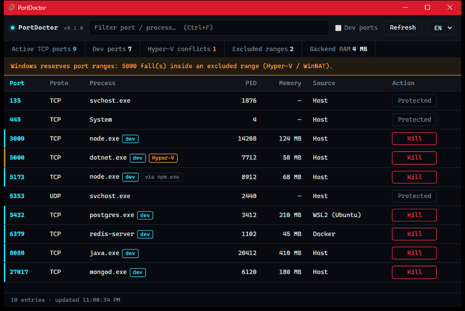
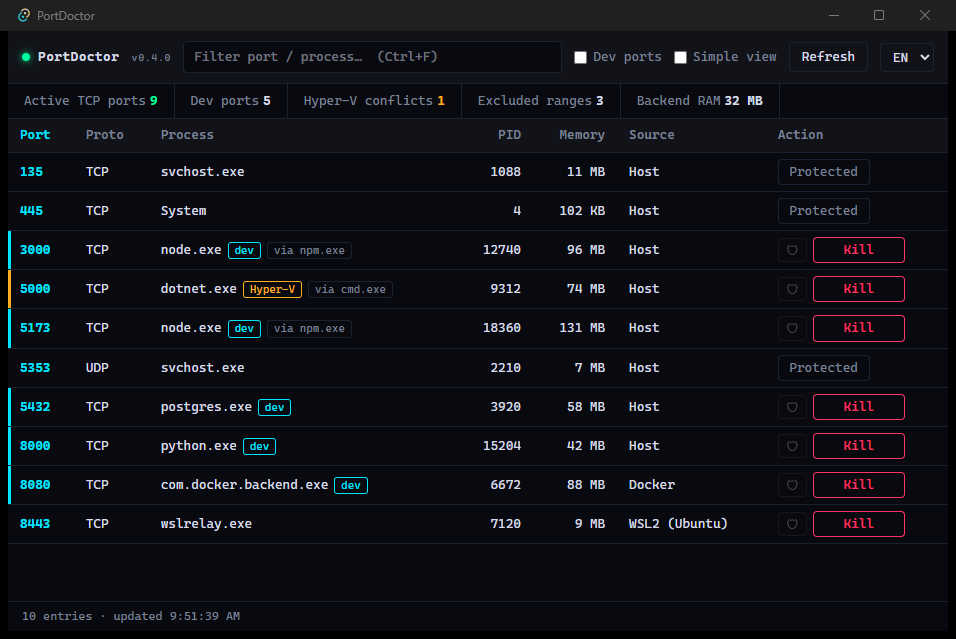
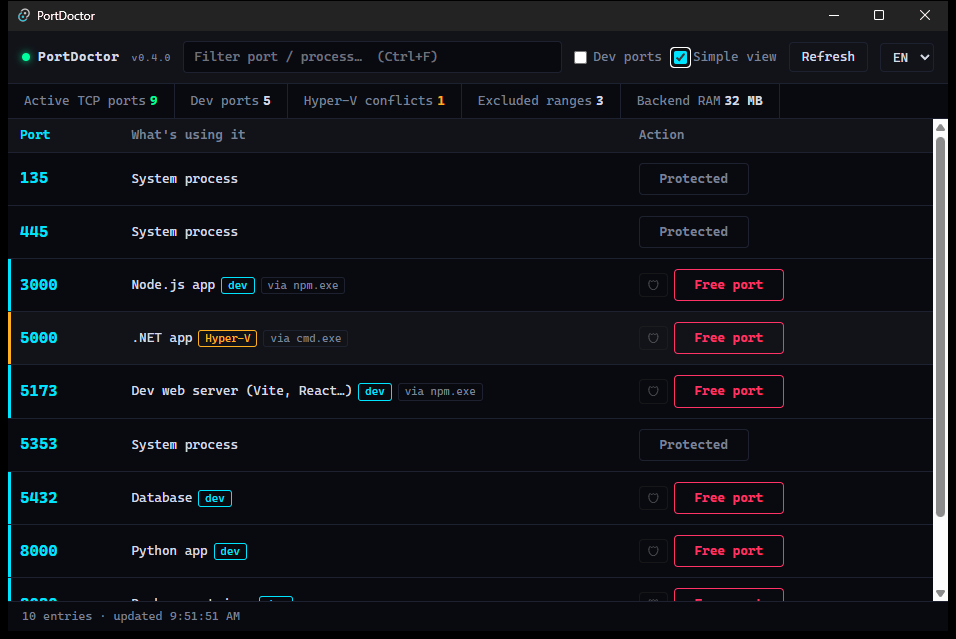
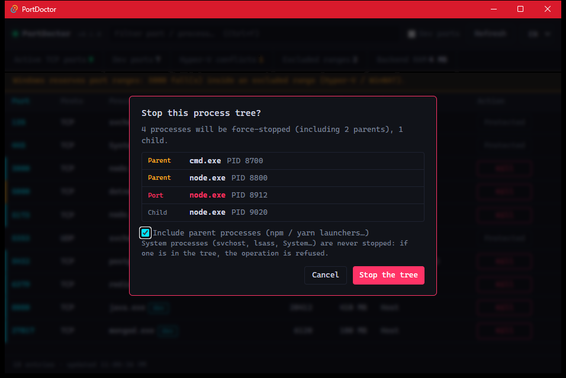
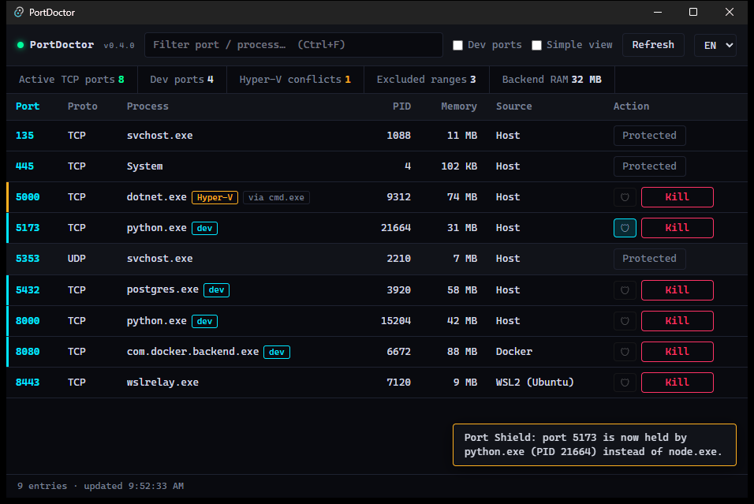

# PortDoctor (v0.6.0)

🇫🇷 [Version française](README.fr.md)

[](https://github.com/TxF-AI/port-doctor/releases/latest)


[](LICENSE)

**Free blocked ports on your Windows PC in one click, straight from the system tray.**

## The problem: `EADDRINUSE`

```
Error: listen EADDRINUSE: address already in use :::3000
```

A `npm run dev` closed in a hurry, a zombie `node.exe` still holding port 3000, a forgotten `postgres` inside WSL2, a port range silently reserved by Hyper-V: you lose ten minutes hunting with `netstat -ano | findstr :3000`, then `taskkill`.

**PortDoctor** lists every listening port, tells you who holds it (process, path, memory, Host / WSL2 / Docker origin) and frees the port in one click, with guardrails so it never touches Windows itself. Native app (Rust + Tauri v2), a single portable ~4.3 MB executable, discreet in the system tray. Nothing is sent over the Internet. The interface is **bilingual FR / EN** (selector at the top right; defaults to the system language).

## 🎯 Who is it for?

* **AI-Assisted Coders (Cursor, Claude Code, Copilot):** Effortlessly resolve `EADDRINUSE` port conflicts generated during AI coding sessions using **Simple View**, with zero terminal commands (`netstat`, `taskkill`) required.
* **Full-Stack & Web Developers:** Instantly visualize process trees (parent ➔ child) and safely terminate ghost processes holding onto Vite, Next.js, or backend API ports.
* **DevOps & SysAdmins:** Native, ultra-lightweight Windows tool (~32 MB RAM footprint) with automatic WSL2 & Hyper-V port reservation detection.

## 🎨 Interface preview



*Animated demo (fictitious data): switch to the **Simple view** (plain-language labels, big **Free port** button), free a port (confirmation, a **toast** notification and the row fades out), then Smart Kill on port 5173: the modal shows the process tree (`cmd` → `node` → `node` → child), and a toast confirms the port is freed. Finally the **Port Shield**: click the shield on port 5173 (toast "port 5173 is watched"), then a yellow alert warns that another process (`python.exe`) now holds the port instead of `node.exe`.*

<details>
<summary>Static screenshots</summary>



A compact **cyberpunk HUD**, opened from the **system tray** icon (left click). The dense table lists **TCP and UDP** ports with PID, process, memory and **source**: `Host`, `WSL2 (Ubuntu)` or `Docker`. The counter bar summarizes active ports, **Dev ports** (filter and blue edge), and **Hyper-V conflicts** (amber edge and badge: here port 5000 falls inside a reserved range); system processes are locked (`Protected`). The search box (`Ctrl+F`) filters by port, name or PID.



The **Simple view** (checkbox in the header, remembered between launches) hides PID, memory and technical columns: each port shows a plain label ("Node.js app", "Database", "Docker container"…) and a big **Free port** button. After each action a small **toast** confirms the result and the row fades out.



When a process has children or an `npm` / `yarn` launcher above it, the **Kill** button opens the **Smart Kill** modal: it lists the exact tree (parents, port owner, children) and lets you exclude the parents before stopping.



The **Port Shield** (small shield button before **Kill** / **Free port**, on every unprotected TCP row): click it to watch a port. If another process takes it, a yellow alert toast tells you which one (here `python.exe` instead of `node.exe`). Alert only: PortDoctor never stops anything on its own.

> The screenshots use **demo data** (no user name and no real process from the machine).

</details>

## Features

| Feature | Details |
|---|---|
| 🔌 **System tray inspection** | Listening TCP ports and bound UDP sockets, with address (`0.0.0.0`, `127.0.0.1`, `::1`), PID, process, path, memory. Sorting, instant filter (`Ctrl+F`), "Dev ports" view (3000, 3001, 4200, 5173, 8000, 8080, 3306, 5432, 6379, 27017). Closing the window minimizes it to the tray. |
| 💥 **One-click Kill** | Forced stop of the process holding the port, after a visual confirmation ("Confirmer ?" on the button). |
| 🌳 **Smart Kill (tree)** | If the process has children or an `npm` / `yarn` / `pnpm` / `nodemon` launcher above it, a modal lists the exact tree (parents, port owner, children) before stopping. Parents are an opt-in checkbox. |
| 🛡️ **Guardrails** | `System`, `svchost.exe`, `lsass.exe`, `csrss.exe`, `services.exe`… are locked, in the backend too. A tree containing a protected process is refused as a whole. PortDoctor never stops itself or its ancestors, and an ordinary shell or terminal is never mistaken for a launcher. |
| 🛡️ **Port Shield** | Click the shield next to a port to watch it. If another process takes it, or the one you expected lets go of it, PortDoctor shows a warning toast, flashes the taskbar and brings the window back from the tray. Alert only: nothing is ever stopped automatically. The expected process is matched by name, so restarting the same server does not trigger a false alarm. Checked every 2 seconds, and only when at least one port is shielded. |
| 📋 **Copy AI diagnostic** | The **📋 AI Prompt** button on each row copies a Markdown summary of that port (process, PID, parent, path, memory, listening addresses, Port Shield state, Hyper-V range) with a ready-made question, to paste into Claude Code, Cursor or any AI assistant. Nothing is sent anywhere: it only goes to your clipboard. |
| ⚡ **Common ports at a glance** | In the Simple view, four cards show the usual dev ports (3000 Node / React, 5173 Vite, 8080 Java / Web, 5432 PostgreSQL): free or in use, by which program and PID, with the **Free port** button and the Port Shield toggle on each card. |
| 🌗 **Light / dark theme** | A ☀️ / 🌙 button in the header switches the theme. The choice is remembered. |
| 👁️ **Simple view** | A toggle that hides PIDs and technical columns and names what holds the port in plain words ("Dev web server (Vite, React…)", "Python app", "Database", "Docker container"). One big **Free port** button. Remembered between launches; the Advanced view keeps every detail. |
| 🌐 **Languages** | Interface and backend messages in French or English, your choice (remembered). The tray menu follows the language. |
| 🐧 **WSL2 mapping** | Ports relayed by `wslrelay.exe` are labelled with the running distribution: `WSL2 (Ubuntu)`. Container ports are marked `Docker`. |
| ⚠️ **Hyper-V diagnostics** | Reads the port ranges excluded by Windows (`netsh interface ipv4 show excludedportrange`) and warns when a dev port (e.g. 5000) falls inside a reserved range. |

## Installation

1. Download **[port-doctor.exe (v0.6.0)](https://github.com/TxF-AI/port-doctor/releases/download/v0.6.0/port-doctor.exe)** from the [release page](https://github.com/TxF-AI/port-doctor/releases/tag/v0.6.0).
2. Check its hash:

   ```powershell
   Get-FileHash -Algorithm SHA256 .\port-doctor.exe
   ```

   The result must be:

   ```
   F2A5F440C5BFCD9F7546A48E767FF2E4CB96E5987ED6BEC531CD846C67BD51BE
   ```

3. Double-click `port-doctor.exe`. No installation: the file is portable. The icon appears in the notification area (left click to show, right click to quit).

**Requirements:** Windows 10 or 11 (64-bit) with Microsoft Edge WebView2, already present on Windows 11 and up-to-date Windows 10.

> ### ⚠️ Windows SmartScreen
> The executable is **not digitally signed** (no code-signing certificate). On first launch Windows may show "Windows protected your PC": click **More info**, then **Run anyway**. Always compare the SHA-256 hash above before running it. You can also remove the block with `Unblock-File .\port-doctor.exe`.

## Usage notes

- Stopping a process started as administrator requires running PortDoctor as administrator.
- When several WSL2 distributions are running, the port does not tell which one opens it: the Source column lists them all (`WSL2 (Ubuntu, Debian)`).
- Docker Desktop's internal distributions (`docker-desktop`) are not shown.

## Build from source

Requirements: Rust (stable, MSVC), Node.js and the Visual Studio C++ Build Tools.

```powershell
npm install
npm run tauri dev                          # development
cd src-tauri; cargo test                   # tests (including real processes)
cd src-tauri; cargo clippy --all-targets   # lint
npm run tauri build -- --no-bundle         # executable: src-tauri\target\release\port-doctor.exe
```

## Structure

| Path | Role |
|---|---|
| `src-tauri/src/ports.rs` | socket scan, guardrails, Smart Kill, WSL2, Hyper-V ranges |
| `src-tauri/src/models.rs` | types exchanged with the interface |
| `src-tauri/src/lib.rs` | Tauri commands and system tray |
| `src/` | interface in plain JavaScript modules, no framework on purpose (keeps the app tiny): `state.js` (shared state), `render.js` (table, counters, Simple view), `toast.js` (notifications), `shield.js` (Port Shield), `kill.js` and `tree-dialog.js` (Kill and Smart Kill), `i18n.js` (FR/EN), `main.js` (entry point) |
| `index.html` | page skeleton (Vite, Tailwind v4) |
| `CHANGELOG.md` | what changed in each version, with dates |
| `CLAUDE.md` | project memory: commands, conventions, lessons learned (in French) |

## 📜 License

This project is released under the **MIT** license: you may use, copy, modify and redistribute it freely, as long as you keep the copyright notice. The full text is in the [LICENSE](LICENSE) file. Copyright (c) 2026 TxF-AI.
